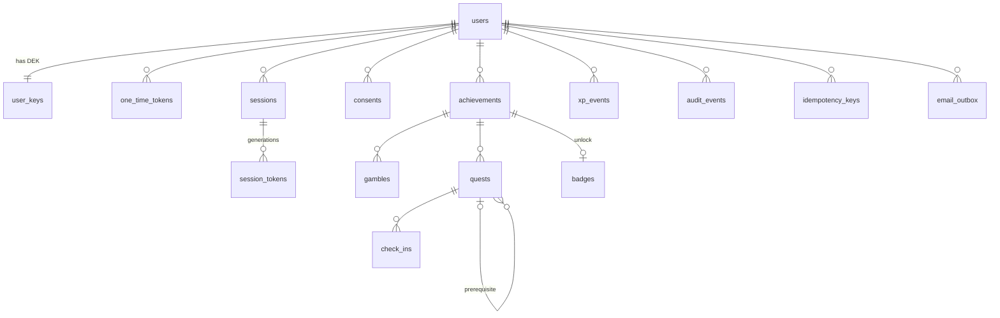

# Data model (PostgreSQL)

Status: M0 proposal (2026-10-22). Drizzle schema and migrations are written in M1–M4 from this document.
Column classification for privacy (purpose, legal basis, export/deletion coverage) lives in
`docs/privacy/data-inventory.md` and its machine-readable twin `docs/privacy/data-inventory.yaml`.

## 1. Conventions

- **IDs**: `uuid` v4 generated by the application (`crypto.randomUUID()`), never sequential (R-OUT-02). The ID is
  generated before the insert because it is part of the AEAD associated data.
- **Timestamps**: `timestamptz`, set by the application from the injected `Clock` (deterministic tests). `local_date`
  columns are `date` values in the **user's** timezone, computed/validated at write time (ADR-0011).
- **Encrypted columns** end in `_enc` and are `bytea`: `0x01 ‖ nonce(24) ‖ ciphertext+tag`, AEAD XChaCha20-Poly1305,
  AD = `questline|v1|<user_id>|<record_id>|<column>` (ADR-0006). Each row that has encrypted columns also carries
  `dek_version` so fields can be re-encrypted during key rotation.
- **Ownership**: every table holding user data carries `user_id` (denormalised where needed) so that (a) all queries
  filter on it, (b) Row-Level Security can enforce it, (c) deletion is a cascade from `users`.
- **Concurrency**: mutable resources have `version integer NOT NULL DEFAULT 1`, incremented on every update
  (ADR-0008).
- **Enums** are `text` columns with `CHECK` constraints (easier to evolve than PostgreSQL enums).
- **Numeric values** (`start_value`, `target_value`, check-in `value`) are decimals serialised as canonical strings
  before encryption (`"80.5"`), so no float rounding leaks into ciphertext comparisons.

## 2. Entity overview



Tables without a user relation: `rate_limit_buckets`, `deleted_user_tombstones`, `job_runs`,
`drizzle.__drizzle_migrations`.

## 3. Tables

Legend: 🔒 = application-level encrypted · 🔑 = secret stored only as hash · RLS = row-level security policy applies
(`user_id = current_setting('app.user_id', true)::uuid`) · ⟂ = exempt from RLS because the lookup is by secret hash
or blind index before the user is known (narrow repository API, explicit filters, dedicated tests).

### 3.1 Accounts & authentication

#### `users` ⟂

| Column | Type | Notes |
|--------|------|-------|
| `id` | uuid PK | |
| `email_enc` 🔒 | bytea NOT NULL | AD record id = `id` |
| `email_blind_index` | bytea(32) NOT NULL UNIQUE | HMAC-SHA256(blind-index key, normalised email) (R-ENC-02) |
| `password_hash` 🔑 | text NOT NULL | Argon2id PHC string |
| `nickname_enc` 🔒 | bytea NULL | A-01 |
| `timezone` | text NOT NULL | IANA, stored under its canonical name (A-02) |
| `locale` | text NOT NULL | contract allowlist, default `de-CH` (A-29) |
| `week_start` | text NOT NULL DEFAULT 'monday' CHECK IN (`monday`, `sunday`, `saturday`) | Q-18 |
| `age_confirmed` | boolean NOT NULL | self-declared ≥ 13 (Q-23); registration rejected if false |
| `email_verified_at` | timestamptz NULL | NULL = unverified → purged after 7 days |
| `deactivated_at` | timestamptz NULL | deletion requested (Q-11); login reactivates within 30 days, then hard delete |
| `privacy_policy_version` | text NOT NULL | A-14 |
| `password_changed_at` | timestamptz NOT NULL | |
| `created_at`, `updated_at` | timestamptz NOT NULL | |
| `version` | integer NOT NULL | |

Lookups: by `id` (after auth) and by `email_blind_index` (login, register, forgot, resend). No other access path.

#### `user_keys` RLS

| Column | Type | Notes |
|--------|------|-------|
| `user_id` | uuid PK → `users` ON DELETE CASCADE | |
| `wrapped_dek` 🔑 | bytea NOT NULL | DEK wrapped by the KEK (`KeyWrapper`) |
| `kek_id` | text NOT NULL | KEK identifier (1Password item reference in production, `local` in dev/test — ADR-0013) |
| `kek_version` | integer NOT NULL | |
| `dek_version` | integer NOT NULL | current version used for new writes |
| `created_at`, `rotated_at` | timestamptz | |

Deleting this row (with the user) is the crypto-shredding step (ADR-0006).

#### `one_time_tokens` ⟂

| Column | Type | Notes |
|--------|------|-------|
| `id` | uuid PK | |
| `user_id` | uuid → `users` CASCADE | |
| `purpose` | text CHECK IN (`verify_email`, `change_email`, `reset_password`) | |
| `token_hash` 🔑 | bytea(32) NOT NULL UNIQUE | SHA-256 of the 256-bit random token |
| `new_email_enc` 🔒 | bytea NULL | `change_email` only |
| `new_email_blind_index` | bytea(32) NULL | `change_email` only |
| `expires_at` | timestamptz NOT NULL | ≤ 30 min after creation (R-AUTH-03) |
| `used_at` | timestamptz NULL | single use |
| `created_at` | timestamptz NOT NULL | |

Issuing a new token of the same purpose deletes the older unused ones. A completed `reset_password` also sets `users.email_verified_at` if it was empty: the link reached the address (A-30). A `change_email` token keeps the requested address in `new_email_enc` (user's DEK, AD record id = the token's `id`); confirming it re-encrypts the address into `users.email_enc`, sets the new blind index (a savepoint turns a unique violation into `409 email-taken`), marks it verified, bumps `version` and deletes every other unused token of the user, so links sent to the old address stop working. A used `verify_email` token is kept until the
cleanup, so a repeated verification answers `204` and changes nothing (contract); used/expired rows are deleted
hourly.

#### `sessions` RLS

| Column | Type | Notes |
|--------|------|-------|
| `id` | uuid PK | returned to the client as `session_id` |
| `user_id` | uuid → `users` CASCADE | |
| `client` | text CHECK IN (`ios`, `android`) | Q-09 |
| `device_label_enc` 🔒 | bytea NULL | user-chosen, ≤ 64 chars (Q-09) |
| `created_at`, `last_used_at` | timestamptz NOT NULL | `last_used_at` follows logins and refreshes (≤ 15 min apart while the app is in use), not every request |
| `last_reauth_at` | timestamptz NOT NULL | login or `POST /v1/auth/reauth`; drives R-AUTH-06 |
| `absolute_expires_at` | timestamptz NOT NULL | created + 180 d (A-10) |
| `revoked_at` | timestamptz NULL | |
| `revoked_reason` | text NULL CHECK IN (`logout`, `logout_all`, `user_revoked`, `password_changed`, `password_reset`, `refresh_reuse`, `expired`, `account_deleted`, `session_limit`) | `session_limit`: logged out to make room for a new login (Q-29, migration 0003) |

Session rows are deleted 7 days after their revocation, their absolute expiry or the end of their refresh lifetime (last use + 30 d). Revocation deletes a session's tokens at once; otherwise a token generation is deleted when its refresh token expires — rotated generations stay until then, so a replayed refresh token is still recognised as reuse (hourly purge jobs, architecture §4.7).

#### `session_tokens` ⟂

| Column | Type | Notes |
|--------|------|-------|
| `id` | uuid PK | |
| `session_id` | uuid → `sessions` CASCADE | |
| `user_id` | uuid → `users` CASCADE | denormalised |
| `generation` | integer NOT NULL | 1, 2, 3 … per rotation; UNIQUE (`session_id`, `generation`) |
| `access_token_hash` 🔑 | bytea(32) NOT NULL UNIQUE | |
| `access_expires_at` | timestamptz NOT NULL | ≤ 15 min |
| `refresh_token_hash` 🔑 | bytea(32) NOT NULL UNIQUE | |
| `refresh_expires_at` | timestamptz NOT NULL | 30 d sliding |
| `rotated_at` | timestamptz NULL | set when this generation's refresh token was used |
| `created_at` | timestamptz NOT NULL | |

Access-token lookup: `access_token_hash = $1 AND access_expires_at > now()` in `session_tokens` (RLS-exempt), then,
bound to that user, the session with `revoked_at IS NULL AND absolute_expires_at > now()` (RLS).
Refresh: a hit with `rotated_at IS NOT NULL` = reuse → session revoked (`refresh_reuse`) and audited. Old
generations stay until the session ends so reuse is always detected. The refresh locks its generation row
(`FOR UPDATE`), so two concurrent uses of one token are serialised: the first rotates, the second is reuse. Access and
refresh expiries never exceed the session's `absolute_expires_at`; an access token stays valid until it expires (or
its session is revoked), also after a refresh.

### 3.2 Consent

#### `consents` RLS

| Column | Type | Notes |
|--------|------|-------|
| `id` | uuid PK | |
| `user_id` | uuid → `users` CASCADE | |
| `type` | text CHECK IN (`goal_content`) | |
| `version` | text NOT NULL | consent text version shown by the app |
| `granted_at` | timestamptz NOT NULL | |
| `withdrawn_at` | timestamptz NULL | partial UNIQUE (`user_id`, `type`) WHERE `withdrawn_at IS NULL` |

History is kept for the lifetime of the account as proof of the lawful processing period; deleted with the account.

### 3.3 Goal content

#### `achievements` RLS

| Column | Type | Notes |
|--------|------|-------|
| `id` | uuid PK | |
| `user_id` | uuid → `users` CASCADE | |
| `title_enc` 🔒 | bytea NOT NULL | |
| `description_enc` 🔒 | bytea NULL | |
| `motivation_enc` 🔒 | bytea NULL | |
| `category_enc` 🔒 | bytea NULL | |
| `target_date_enc` 🔒 | bytea NULL | encrypted (Q-24); decrypted in-process for lateness and gamble settlement |
| `deadline_enc` 🔒 | bytea NULL | the attempt's deadline: earliest `target_date` in effect during the current attempt (Q-31, A-35), used for lateness and Champion; reset when a new attempt starts; not an API field |
| `status` | text CHECK IN (`active`, `paused`, `completed`) NOT NULL | client: `active ↔ paused`; `completed` system-only, read-only, not deletable (R-ACH-07) |
| `is_private` | boolean NOT NULL DEFAULT false | display hint only |
| `attempt` | integer NOT NULL DEFAULT 1 | incremented when resuming from `paused` (pause = reset, R-ACH-06) |
| `completed_at` | timestamptz NULL | |
| `execution_score` | numeric(5,2) NULL | 0–100, set on unlock (R-RANK-01) |
| `rank` | text NULL CHECK IN (`unranked`, `bronze`, `silver`, `gold`, `platinum`, `emerald`, `diamond`, `champion`) | set on unlock (R-RANK-02) |
| `dek_version` | integer NOT NULL | |
| `created_at`, `updated_at` | timestamptz NOT NULL | |
| `version` | integer NOT NULL | |

Index `(user_id, status, created_at, id)` for cursor pagination, scanned backwards for newest-first pages.
`UNIQUE (id, user_id)` is the target of the children's composite foreign keys. CHECK: `completed` exactly when
`completed_at`, `execution_score` (0–100) and `rank` are set. A restrictive policy keeps a `completed` achievement
undeletable for the API until the goal-content consent is withdrawn (R-ACH-07, Q-10).

#### `gambles` RLS (R-GMB-*)

| Column | Type | Notes |
|--------|------|-------|
| `id` | uuid PK | |
| `user_id` | uuid NOT NULL | the achievement's user (composite FK below); partial UNIQUE (`user_id`) WHERE `status = 'pending'`: one pending gamble per user (Q-31) |
| `achievement_id` | uuid NOT NULL | `(achievement_id, user_id)` → `achievements (id, user_id)` CASCADE |
| `attempt` | integer NOT NULL | attempt during which it was placed |
| `stake` | bigint NOT NULL CHECK > 0 | XP above the level threshold at placement |
| `status` | text CHECK IN (`pending`, `won`, `lost`) NOT NULL | |
| `loss_reason` | text NULL CHECK IN (`target_date_passed`, `habit_reset`, `paused`, `deleted`) | set exactly when `lost` |
| `placed_at`, `settled_at` | timestamptz | `settled_at` set exactly when not `pending`, never before `placed_at` |

History of won/lost gambles is kept (counts against Champion, R-RANK-02) until the achievement or account is deleted.
Index `(achievement_id)`.

#### `quests` RLS

| Column | Type | Notes |
|--------|------|-------|
| `id` | uuid PK | |
| `user_id` | uuid NOT NULL | the achievement's user (composite FK below) |
| `achievement_id` | uuid NOT NULL | `(achievement_id, user_id)` → `achievements (id, user_id)` CASCADE; never changes |
| `position` | integer NOT NULL | client-managed order |
| `type` | text CHECK IN (`one_time`, `habit`, `target`) NOT NULL | immutable |
| `size` | text CHECK IN (`S`, `M`, `L`) NOT NULL | XP 10/25/50 derived in code |
| `is_required` | boolean NOT NULL DEFAULT true | |
| `prerequisite_quest_id` | uuid NULL | `(prerequisite_quest_id, achievement_id)` → `quests (id, achievement_id)` ON DELETE SET NULL (`prerequisite_quest_id`): the key itself keeps it in the same achievement; not the quest itself; acyclic, chains ≤ 20 links (checked in service, A-16); for a habit fixed once its run has begun (Q-38) |
| `title_enc` 🔒 | bytea NOT NULL | |
| `notes_enc` 🔒 | bytea NULL | |
| `unit_enc` 🔒 | bytea NULL | target only |
| `start_value_enc` 🔒 | bytea NULL | target only |
| `target_value_enc` 🔒 | bytea NULL | target only |
| `habit_period` | text NULL CHECK IN (`day`, `week`) | habit only |
| `habit_times_per_period` | integer NULL CHECK 1..50 | habit only |
| `habit_period_count` | integer NULL CHECK 1..520 | habit only |
| `habit_start_date` | date NULL | habit only; start of the current attempt's period sequence (re-set on restart; moved to the unlock day when a locked habit unlocks after it, Q-38) |
| `habit_week_start` | text NULL CHECK IN (`monday`, `sunday`, `saturday`) | weekly habits only (NOT NULL iff `habit_period = 'week'`): the account's `week_start` when this run started, kept until the next restart (Q-34) or an edit before the run begins (A-41) |
| `reset_count` | integer NOT NULL DEFAULT 0 | habit resets within the current achievement attempt (R-QST-04, R-RANK-01) |
| `habit_best_streak` | integer NOT NULL DEFAULT 0 CHECK ≥ 0 | the longest met-period count of this quest's ended runs (a reset or a pause); kept because a restart replaces `habit_start_date`. The API's best streak is the larger of this and the current run (R-STR-01) |
| `needs_restart` | boolean NOT NULL DEFAULT false | set by a habit reset; cleared when the user edits `habit.start_date` |
| `completed_at` | timestamptz NULL | set/cleared by the effects engine |
| `dek_version` | integer NOT NULL | |
| `created_at`, `updated_at` | timestamptz NOT NULL | |
| `version` | integer NOT NULL | |

`CHECK` constraints enforce "type-specific columns are NOT NULL iff the type matches" (`unit_enc` optional for
targets), and that `reset_count`, `habit_best_streak` and `needs_restart` stay at their defaults for non-habits and a
quest that needs a restart is not completed. Effective XP (`base × duration factor`, R-XP-02) is derived in code, not
stored. The habit columns change only at a restart, before the run's start date, or while the habit is locked or its
achievement paused (Q-37, Q-38, A-39); such an edit gives the run the account's current `week_start` (A-41). An edit
re-encrypts every encrypted column under the current data key. Deleting a quest clears `prerequisite_quest_id` on the
quests that named it itself, bumping their `version` (R-QST-08); the foreign-key action is only the safety net.
Pausing the achievement ends the attempt for every quest: `completed_at` cleared, `needs_restart` false, `reset_count`
0, a habit's run kept in `habit_best_streak`; resuming moves a habit's passed `habit_start_date` to the resume day with
that day's week start (R-ACH-06, A-39).
Index `(achievement_id, position)`, `(user_id)`; `UNIQUE (id, user_id)` and `(id, achievement_id)` are the targets of
the composite foreign keys.

#### `check_ins` RLS

| Column | Type | Notes |
|--------|------|-------|
| `id` | uuid PK | |
| `user_id` | uuid NOT NULL | the quest's user (composite FK below) |
| `quest_id` | uuid NOT NULL | `(quest_id, user_id)` → `quests (id, user_id)` CASCADE |
| `local_date` | date NOT NULL | user's day (R-CHK-04) |
| `attempt` | integer NOT NULL | achievement attempt at creation; older attempts are history |
| `counts_for_progress` | boolean NOT NULL | true only if `local_date` = today at creation (R-CHK-04) |
| `value_enc` 🔒 | bytea NULL | target only |
| `note_enc` 🔒 | bytea NULL | |
| `dek_version` | integer NOT NULL | |
| `created_at` | timestamptz NOT NULL | |

Immutable (no `version`, no UPDATE grant); an undo deletes the row, possible only on the day it was created in the
account's time zone (Q-36). A completed quest takes no further check-ins (Q-42). At most 50 check-ins of a quest are
dated any one day (R-IN-01, A-42). Index `(quest_id, attempt, local_date) WHERE counts_for_progress` and
`(quest_id, created_at, id)` (scanned backwards for newest-first pages).

### 3.4 Gamification

#### `xp_events` RLS — append-only ledger (R-XP-01)

| Column | Type | Notes |
|--------|------|-------|
| `id` | uuid PK | |
| `user_id` | uuid → `users` CASCADE | |
| `kind` | text CHECK IN (`quest_completed`, `quest_uncompleted`, `rank_bonus`, `rank_bonus_revoked`, `gamble_won`, `gamble_lost`, `gamble_reverted`, `pause_revoked`, `quest_deleted`, `achievement_deleted`, `xp_floor`) | `gamble_reverted`: an undo re-locked the unlock that won the gamble; `xp_floor`: see below (A-38) |
| `amount` | bigint NOT NULL | signed: CHECK > 0 for the credits `quest_completed`, `rank_bonus`, `gamble_won`, `xp_floor`, < 0 for every other kind (never 0) |
| `quest_id` | uuid NULL | `(quest_id, user_id)` → `quests (id, user_id)` ON DELETE SET NULL (`quest_id`) |
| `achievement_id` | uuid NULL | `(achievement_id, user_id)` → `achievements (id, user_id)` ON DELETE SET NULL (`achievement_id`) |
| `gamble_id` | uuid NULL | `(gamble_id, user_id)` → `gambles (id, user_id)` ON DELETE SET NULL (`gamble_id`) |
| `local_date` | date NOT NULL | for "XP over time" (A-13) |
| `created_at` | timestamptz NOT NULL | |

Total XP = `SUM(amount)`, never below 0: revocations are exact, so if a lost gamble took XP that is later revoked, an
`xp_floor` event brings the sum back to 0 (R-XP-04, A-38); level derived in code. Exactly-once is guaranteed by the
effects engine (`src/domain/effects.ts`), which appends only the difference between the XP the ledger credits and
the XP the state deserves, run by the goal engine (`src/modules/goals/engine.ts`) under a per-user transaction lock.
Deleting a quest, achievement or gamble keeps its ledger rows and clears only the reference (the column list keeps
`user_id`; PostgreSQL ≥ 15). The API has no UPDATE grant, and a restrictive policy lets it delete ledger rows only
after the goal-content consent is withdrawn (Q-10). Indexes `(user_id, local_date)` and partial `(quest_id)`,
`(achievement_id)`, `(gamble_id)` (sums per quest/achievement for the effects engine; unlinking on deletion).

#### `badges` RLS

| Column | Type | Notes |
|--------|------|-------|
| `id` | uuid PK | |
| `user_id` | uuid NOT NULL | the achievement's user (composite FK below) |
| `achievement_id` | uuid NOT NULL | `(achievement_id, user_id)` → `achievements (id, user_id)` CASCADE; UNIQUE with `kind` |
| `kind` | text CHECK IN (`achievement_rank`) | A-06 |
| `rank` | text NOT NULL | same enum as `achievements.rank` |
| `awarded_at` | timestamptz NOT NULL | |

Removed on re-lock (R-ACH-05) and on achievement deletion. Index `(user_id)`.

### 3.5 Security & operations

#### `audit_events` RLS (R-LOG-03)

| Column | Type | Notes |
|--------|------|-------|
| `id` | uuid PK | |
| `user_id` | uuid NULL → `users` CASCADE | NULL for failed logins against unknown emails |
| `event_type` | text NOT NULL | `login_succeeded`, `login_failed`, `logout`, `session_revoked`, `refresh_reuse_detected`, `password_changed`, `password_reset_requested`, `password_reset_completed`, `email_change_requested`, `email_changed`, `email_verified`, `consent_granted`, `consent_withdrawn`, `export_requested`, `account_deleted`, `account_reactivated` (§5 step 2, added in M2), `reauth_succeeded`, `reauth_failed`, `rate_limited` |
| `session_id` | uuid NULL | not a FK (session may be gone) |
| `ip_prefix` | cidr NULL | truncated: IPv4 /24, IPv6 /48 — `cidr` refuses host bits and a CHECK refuses longer masks, so the database cannot store a full address (M2; was `text`) |
| `client` | text NULL | `ios` / `android` |
| `outcome` | text CHECK IN (`success`, `failure`) | |
| `metadata` | jsonb NOT NULL DEFAULT '{}' | allowlisted keys only (reason codes) |
| `created_at` | timestamptz NOT NULL | |

Retention 90 days (worker job). Included in export; deleted with the account.

#### `idempotency_keys` RLS (ADR-0008, Q-39)

| Column | Type | Notes |
|--------|------|-------|
| `id` | uuid PK | AD record id of `response_body_enc` |
| `user_id` | uuid → `users` CASCADE | |
| `route` | text NOT NULL CHECK IN (`createAchievement`, `createQuest`, `placeGamble`, `createCheckIn`) | `operationId` |
| `key` | uuid NOT NULL | UNIQUE (`user_id`, `route`, `key`) |
| `request_hash` | bytea(32) NOT NULL | SHA-256 of canonical JSON (sorted properties) of path parameters and body |
| `response_status` | integer NOT NULL CHECK 200–299 | only successful responses are stored (Q-39) |
| `response_body_enc` 🔒 | bytea NOT NULL | JSON `{headers: {etag, location}, body}`; may contain goal content |
| `created_at`, `expires_at` | timestamptz NOT NULL | `expires_at` ≤ `created_at` + 24 h |

Written in the request's own transaction behind an advisory lock on (user, route, key), so it commits with the
effect or not at all; a request whose key's record expired replaces it (UPDATE). Index `(expires_at)` for the hourly
purge job (worker). No `dek_version`: like `email_outbox.payload_enc`, it lives shorter than a key rotation.

#### `email_outbox` (worker role; RLS for the app role)

| Column | Type | Notes |
|--------|------|-------|
| `id` | uuid PK | |
| `user_id` | uuid → `users` CASCADE | only registered users are ever emailed |
| `template` | text NOT NULL | `verify_email`, `registration_notice` (someone tried to register or move an account to this address), `password_reset`, `password_changed_notice`, `email_change_verify` (to the new address), `email_change_notice` (to the old address), `account_deleted_notice` |
| `payload_enc` 🔒 | bytea NOT NULL | JSON `{to, locale, token?}` encrypted with the user's DEK (AD record id = `id`); the worker builds links from config (A-19) — never in plaintext |
| `attempts` | integer NOT NULL DEFAULT 0 | counted when the worker claims the email, so a crash loop still reaches the limit (8) |
| `next_attempt_at` | timestamptz NOT NULL | exponential backoff (1, 2, 4 … 64 min); while an email is being sent, the end of the worker's 5-minute lease |
| `last_error_code` | text NULL | error class only (`smtp_eenvelope_550`, `smtp_etls_500`, `payload_unreadable`), no message text |
| `sent_at`, `dead_at` | timestamptz NULL | |
| `created_at` | timestamptz NOT NULL | |

Sent rows are deleted immediately; dead letters after 7 days. A link email whose token no longer works (used,
replaced by a newer one or expired) is deleted unsent (D-05); notices are always sent.

#### `rate_limit_buckets` (UNLOGGED, no user relation)

| Column | Type | Notes |
|--------|------|-------|
| `bucket_key` | bytea(32) PK | HMAC(daily key, `scope:subject`) — never a raw IP or email (Q-14); daily key = HMAC(`RATE_LIMIT_KEY`, UTC date); subjects: IPv4 address, IPv6 /64, normalised email, user ID |
| `tokens` | double precision NOT NULL | token bucket level |
| `failures` | integer NOT NULL DEFAULT 0 | consecutive failures for progressive backoff |
| `blocked_until` | timestamptz NULL | |
| `updated_at` | timestamptz NOT NULL | rows older than 24 h are deleted |

#### `deleted_user_tombstones` (Q-13)

| Column | Type | Notes |
|--------|------|-------|
| `user_id` | uuid PK | random UUID of the deleted account, nothing else |
| `deleted_at` | timestamptz NOT NULL | retained 35 days, replayed after a restore |

#### `job_runs` (operational, no personal data)

| Column | Type |
|--------|------|
| `id` uuid PK · `job_name` text · `started_at`, `finished_at` timestamptz · `status` text · `processed` integer · `error_code` text NULL |

One row per finished run (`succeeded`, or `failed` with an error class such as `pg_57014`); the latest run of a job decides when it is due again (architecture §4.7). Retention 30 days.

## 4. Roles, grants and RLS (ADR-0003)

```sql
-- roles (created once by the db-init job, src/platform/db/bootstrap.ts; passwords from the secret store)
CREATE ROLE questline_migrator LOGIN;          -- owner of all objects, runs migrations
CREATE ROLE questline_app      LOGIN NOBYPASSRLS;
CREATE ROLE questline_worker   LOGIN NOBYPASSRLS;

REVOKE ALL ON SCHEMA public FROM PUBLIC;
GRANT USAGE ON SCHEMA public TO questline_app, questline_worker;
-- per-table grants: see the matrix below; no TRUNCATE, no REFERENCES, no TRIGGER, no sequences (uuid ids)

-- policy shape, repeated for every RLS table (helper from migration 0000: NULL without a user context)
ALTER TABLE sessions ENABLE ROW LEVEL SECURITY;
ALTER TABLE sessions FORCE ROW LEVEL SECURITY;
CREATE POLICY sessions_app ON sessions TO questline_app
  USING (user_id = app_current_user_id()) WITH CHECK (user_id = app_current_user_id());
CREATE POLICY sessions_worker ON sessions TO questline_worker USING (true) WITH CHECK (true);
```

`app_current_user_id()` returns NULL when `app.user_id` is unset, so a transaction that forgot `SET LOCAL` sees
**no rows** and can insert **nothing** — a fail-closed default.

**Least-privilege grants (M2).** Tested exactly by `test/security/db-roles.test.ts`: a new table fails until its
row is added here and in the test. Cascading deletes need no grant (they run as the table owner).

| Table | `questline_app` (API) | `questline_worker` | Row-level security |
|-------|----------------------|--------------------|--------------------|
| `users` | SELECT, INSERT, UPDATE | SELECT, DELETE | ⟂ lookup by blind index before the user is known |
| `user_keys` | SELECT, INSERT | SELECT | RLS |
| `one_time_tokens` | SELECT, INSERT, UPDATE, DELETE | SELECT, DELETE | ⟂ lookup by token hash |
| `sessions` | SELECT, INSERT, UPDATE | SELECT, DELETE | RLS |
| `session_tokens` | SELECT, INSERT, UPDATE, DELETE | SELECT, DELETE | ⟂ lookup by token hash; a composite FK `(session_id, user_id)` → `sessions(id, user_id)` keeps its user equal to the session's |
| `consents` | SELECT, INSERT, UPDATE | — | RLS |
| `audit_events` | INSERT (own user, or NULL for unknown accounts) | SELECT, DELETE | RLS; the API cannot read audit events |
| `email_outbox` | INSERT | SELECT, UPDATE, DELETE | RLS |
| `rate_limit_buckets` | SELECT, INSERT, UPDATE | SELECT, DELETE | ⟂ no user relation; UNLOGGED |
| `deleted_user_tombstones` | — | SELECT, INSERT, DELETE | ⟂ no user relation |
| `job_runs` | — | SELECT, INSERT, UPDATE, DELETE | ⟂ no personal data |
| `achievements` (M3) | SELECT, INSERT, UPDATE, DELETE — a `completed` one only after the goal-content consent is withdrawn (restrictive policy) | — | RLS |
| `gambles` (M3) | SELECT, INSERT, UPDATE | — | RLS; history, deleted with the achievement |
| `quests` (M3) | SELECT, INSERT, UPDATE, DELETE | — | RLS |
| `check_ins` (M3) | SELECT, INSERT, DELETE | — | RLS; immutable, an undo deletes |
| `xp_events` (M3) | SELECT, INSERT, DELETE — only after the goal-content consent is withdrawn (restrictive policy) | — | RLS; append-only ledger |
| `badges` (M3) | SELECT, INSERT, DELETE | — | RLS |
| `idempotency_keys` (M3) | SELECT, INSERT, UPDATE (replacing an expired record), DELETE (consent withdrawal, Q-10; migration 0006) | SELECT, DELETE (purge) | RLS |

The worker gets no goal-content privileges in migration 0004; the daily habit and gamble jobs (M3) add exactly what
they need.
`test/security/rls-coverage.test.ts` fails for any table that is neither RLS-protected nor listed as ⟂, and for any
API policy that is not bound to `app_current_user_id()`.

**Constraints as a second line of defence (M2).** CHECK constraints refuse what the code must never write:
one-time tokens living longer than 30 minutes or mixing up purpose and pending email; access tokens over 15 minutes,
refresh tokens over 30 days, sessions over 180 days; revocation without reason; `age_confirmed = false`; a second
active consent of one type; hashes, blind indexes and bucket keys that are not 32 bytes; outbox error codes that are
not short identifiers (no free text that could contain an address). Tested in `test/integration/account-schema.test.ts`.

**Goal content (M3, migration 0004).** Every child row references its parent together with `user_id` (composite
foreign keys, like `session_tokens`), so no row can hang below another user's achievement, quest or gamble even if a
service forgot a check (T-01), and a prerequisite must lie in the same achievement. CHECK constraints refuse unknown
enum values, type-specific quest columns of the wrong type, habit state on non-habits, inconsistent completion of
achievements and settlement of gambles, a second pending gamble per user, a second rank badge per achievement, and
ledger amounts that are 0 or have the wrong sign. Tested in `test/integration/goal-schema.test.ts`.

## 5. Deactivation and deletion (R-PRIV-06)

1. **Request** (`DELETE /v1/me`, re-auth): sets `users.deactivated_at`, revokes every session and token, writes
   an audit event, sends a notice email with the reactivation deadline. No other endpoint accepts the account.
2. **Reactivation**: a successful `POST /v1/auth/login` within 30 days clears `deactivated_at` (audited).
3. **Hard delete** (worker job, daily): for every user with `deactivated_at < now − 30 days`,
   `DELETE FROM users WHERE id = $1` inside one transaction removes, via `ON DELETE CASCADE`: `user_keys`
   (crypto-shredding), `one_time_tokens`, `sessions` → `session_tokens`, `consents`, `achievements` → (`gambles`,
   `badges`, `quests` → `check_ins`), `xp_events`, `audit_events`, `idempotency_keys`, `email_outbox`. The same
   transaction inserts the tombstone (Q-13). The data-inventory guard test asserts that **every** table with a
   user relation is reached by this cascade and appears in the export.

Consent withdrawal (Q-10) deletes only the goal-content subtree (`achievements` → `gambles`, `badges`, `quests` →
`check_ins`, plus `xp_events` and the stored responses in `idempotency_keys`, which hold goal content for up to 24 h)
in one transaction and leaves the account intact; the consent is marked withdrawn first, which lifts the restrictive
delete policies on completed achievements and the ledger (§4). Code: `deleteGoalContent`
(`src/modules/achievements/repository.ts`), called by the consents service.

## 6. Export document (R-PRIV-05) — shape

```json
{
  "format": "questline-export",
  "version": 1,
  "generated_at": "2026-10-22T10:00:00Z",
  "account": { "id": "…", "email": "…", "nickname": "…", "timezone": "…", "locale": "…", "week_start": "monday", "age_confirmed": true, "created_at": "…", "email_verified_at": "…", "privacy_policy_version": "…", "deactivated_at": null },
  "consents": [ { "type": "goal_content", "version": "…", "granted_at": "…", "withdrawn_at": null } ],
  "sessions": [ { "id": "…", "client": "ios", "device_label": "…", "created_at": "…", "last_used_at": "…", "revoked_at": null } ],
  "achievements": [ { "id": "…", "title": "…", "target_date": "…", "status": "completed", "attempt": 1, "rank": "gold", "execution_score": 78.5, "gambles": [ … ], "quests": [ { "id": "…", "…": "…", "reset_count": 0, "check_ins": [ { "…": "…", "attempt": 1, "counts_for_progress": true } ] } ] } ],
  "xp_events": [ … ], "badges": [ … ], "audit_events": [ … ]
}
```

Hashes (password, tokens) and wrapped keys are **not** exported (they are not personal data the user can use and
exporting them would weaken security); the data inventory documents this exception.
